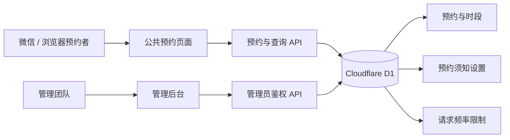

# 学院会议室预约系统


面向学院、实验室、社团和小型团队的移动端会议室预约系统。使用者通过微信或浏览器打开链接即可查看空闲时间并提交预约，无需注册账号；管理团队通过独立后台统一处理预约、钥匙交接、临时时段和预约规则。

系统默认包含“606会议室”和“头脑风暴室”，名称、开放时间、预约范围和提示文字均可配置。

## 如何查看运行效果

在项目根目录打开终端，第一次运行先安装依赖、构建并初始化本地数据库：

```bash
npm ci
npm run build
```

然后按照下方“初始化本地 D1 数据库”和“配置管理员账号”完成一次性设置，启动开发服务器：

```bash
npm run dev
```

终端出现 `http://127.0.0.1:5173/` 后，在当前电脑浏览器打开：

- 用户预约页面：`http://127.0.0.1:5173/`
- 管理后台：`http://127.0.0.1:5173/admin`

修改页面代码后，开发服务器会自动刷新。停止运行时，在启动服务器的终端按 `Ctrl + C`。

`127.0.0.1` 只能从当前电脑访问，微信和其他人的手机无法通过这个地址打开。需要手机扫码体验时，应先部署到可公开访问的 HTTPS 地址，再把用户预约页面地址生成二维码；不要把 `/admin` 管理后台地址制作成公开二维码。

如果依赖、本地数据库和管理员配置都已存在，后续查看效果只需要运行：

```bash
npm run dev
```

## 为什么使用这个项目

- **扫码即用**：公共预约流程不要求登录，适合在学院群、门口海报和公告栏中通过二维码分发。
- **避免重复预约**：服务端使用数据库事务和唯一约束检查时段冲突，多时段预约要么全部成功，要么全部失败。
- **公开与隐私分离**：公共页面只显示时段状态，不展示姓名、学号、班级、电话和借用理由。
- **适合多人管理**：管理员可查看周视图、搜索订单、更新钥匙状态、暂停时段和导出名单。
- **规则可在线维护**：预约须知可以直接在管理后台编辑，不需要修改代码或重新构建前端。
- **移动端优先**：预约端和管理端均适配手机浏览器与微信内置浏览器。

## 功能概览

| 模块 | 能力 |
| --- | --- |
| 会议室与日期 | 多会议室切换、月历选日、未来预约范围限制 |
| 时段选择 | 每小时一档、一次多选、实时占用状态、已过时段自动禁用 |
| 预约信息 | 姓名、学号、班级、11 位手机号码、借用理由 |
| 预约结果 | 提交后立即生效、钥匙领取提示、个人预约凭证 |
| 我的预约 | 当前设备查看、凭证找回、开始前自行取消 |
| 管理后台 | 周视图、订单状态、搜索筛选、预约详情、CSV 导出 |
| 钥匙管理 | 未领取、已借出、已归还三种状态 |
| 临时管控 | 暂停或恢复指定会议室的指定时段 |
| 在线配置 | 添加、删除和修改预约须知，保存后用户端刷新生效 |

## 使用说明

### 预约者

1. 用微信扫码或浏览器打开用户预约页面。
2. 在首页选择会议室，进入日期与时段页面。
3. 选择日期，然后点击一个或多个“可以预约”的时段；再次点击可以取消选择。
4. 点击“下一步”，填写姓名、学号、班级、11 位手机号码和借用理由。
5. 阅读并勾选预约承诺，点击“确认预约”。
6. 预约成功后保存预约凭证。当前设备可以直接在“我的预约”中查看，换手机或清除浏览记录后可以用凭证找回。
7. 尚未开始的预约可以在“我的预约”中取消，取消后对应时段会重新开放。

公共时段表只显示“可以预约”“已约满”“暂停预约”和“已结束”，不会显示预约人的姓名、电话等信息。

### 管理团队

1. 打开站点的 `/admin` 地址，使用已经配置的团队管理员账号登录。
2. 在“预约实况”中切换会议室和周次，点击已预约格子可以查看借用详情。
3. 在“订单列表”中按日期、会议室和状态筛选，或者搜索姓名、学号和手机号码。
4. 在预约卡片中更新钥匙状态；需要取消预约时，打开详情并确认取消。
5. 点击“查看预约名单”可以查看当前筛选结果并导出 CSV。
6. 在“预约配置”中暂停维护时段、恢复时段或修改预约须知。

### 在线修改预约须知

1. 登录 `/admin` 管理后台。
2. 点击底部“预约配置”。
3. 在“编辑预约须知”中修改标题和正文，也可以添加或删除项目。
4. 点击“保存预约须知”。
5. 用户端刷新“预约须知”页面后即可看到最新内容。

预约须知保存在 D1 数据库中，修改后不需要重新构建网站。

### 通过二维码提供预约入口

1. 确认正式站点使用 HTTPS，并且用户首页可以免登录访问。
2. 复制用户首页地址，例如 `https://rooms.example.com/`。
3. 使用可信的二维码工具将该地址生成二维码。
4. 用微信扫码验证首页、日期选择和预约表单可以正常打开。
5. 将二维码放到学院群、公告栏或会议室门口。

二维码应指向用户首页，不应包含管理员账号、密码、预约凭证或 `/admin` 地址。

### 管理员任务速查

| 日常任务 | 操作位置 |
| --- | --- |
| 查看一周预约占用 | 管理后台 → 预约实况 |
| 搜索预约人或电话号码 | 管理后台 → 订单列表 |
| 查看完整借用信息 | 订单列表或预约实况 → 预约详情 |
| 更新钥匙领取状态 | 订单列表 → 钥匙状态 |
| 导出预约名单 | 订单列表 → 查看预约名单 → 导出 CSV |
| 暂停维护或活动时段 | 管理后台 → 预约配置 → 暂停预约时段 |
| 修改预约须知 | 管理后台 → 预约配置 → 编辑预约须知 |

## 系统架构



技术组成：

- React 19 + TypeScript
- Next.js 16 页面与 API 路由约定
- Vinext + Cloudflare Workers
- Cloudflare D1 + Drizzle ORM

## 快速开始

### 环境要求

- Node.js `>= 22.13.0`
- npm

### 安装与构建

```bash
npm ci
npm run build
```

### 初始化本地 D1 数据库

首次运行时，按文件名顺序执行 `drizzle/` 中的迁移。

PowerShell：

```powershell
Get-ChildItem drizzle\*.sql | Sort-Object Name | ForEach-Object {
  node --import ./scripts/sites-env.mjs ./node_modules/wrangler/bin/wrangler.js d1 execute DB --local --config dist/server/wrangler.json --persist-to .wrangler/state --file $_.FullName
}
```

macOS / Linux：

```bash
for file in drizzle/*.sql; do
  node --import ./scripts/sites-env.mjs ./node_modules/wrangler/bin/wrangler.js \
    d1 execute DB --local --config dist/server/wrangler.json \
    --persist-to .wrangler/state --file "$file"
done
```

已经执行过的迁移不要在同一个数据库中重复执行。

### 配置管理员账号

项目提供了管理员配置脚本。脚本会生成 PBKDF2-SHA256 密码散列、随机盐和会话密钥，密码不会写入配置文件或打印到终端。

PowerShell：

```powershell
$env:ADMIN_SETUP_USERNAME = Read-Host "管理员账号"
$env:ADMIN_SETUP_PASSWORD = Read-Host "管理员密码（至少 8 位）" -MaskInput
npm run configure:admin
Remove-Item Env:ADMIN_SETUP_PASSWORD
Remove-Item Env:ADMIN_SETUP_USERNAME
```

macOS / Linux：

```bash
read -r -p "管理员账号: " ADMIN_SETUP_USERNAME
read -r -s -p "管理员密码（至少 8 位）: " ADMIN_SETUP_PASSWORD
echo
export ADMIN_SETUP_USERNAME ADMIN_SETUP_PASSWORD
npm run configure:admin
unset ADMIN_SETUP_USERNAME ADMIN_SETUP_PASSWORD
```

生成的 `.dev.vars` 包含敏感信息，已由 `.gitignore` 排除。请勿将该文件加入版本控制或发送给他人。

### 启动开发服务器

```bash
npm run dev
```

- 用户端：`http://127.0.0.1:5173/`
- 管理后台：`http://127.0.0.1:5173/admin`

## 配置

业务配置集中在 [`lib/config.ts`](./lib/config.ts)：

| 配置项 | 说明 |
| --- | --- |
| `title`、`subtitle` | 站点名称和副标题 |
| `timezone`、`timezoneOffsetHours` | 业务时区 |
| `openingHour`、`closingHour` | 每日开放时间 |
| `advanceBookingDays` | 最多可提前预约的天数 |
| `rooms` | 会议室 ID、名称和标签 |
| `pickupNotice` | 预约成功后的钥匙领取说明 |
| `DEFAULT_NOTICE_ITEMS` | 数据库尚未保存设置时使用的默认须知 |

首页视觉图片位于 `public/reference-room.jpg`，可以替换为自己的会议室照片。

### 环境变量

参考 `.env.example`：

| 变量 | 必填 | 用途 |
| --- | --- | --- |
| `ADMIN_USERNAME` | 是 | 团队管理员账号 |
| `ADMIN_PASSWORD_HASH` | 是 | PBKDF2-SHA256 密码散列 |
| `ADMIN_PASSWORD_SALT` | 是 | 管理员密码盐 |
| `SESSION_SECRET` | 是 | 管理会话和预约查询令牌的签名密钥 |
| `PUBLIC_ORIGIN` | 是 | 允许写请求的站点来源，例如 `https://rooms.example.com` |

生产环境必须使用独立的强密码、随机会话密钥和正确的 HTTPS 来源地址。

## 数据库变更

修改 [`db/schema.ts`](./db/schema.ts) 后生成迁移：

```bash
npm run db:generate
```

新的 `drizzle/*.sql` 文件属于应用版本的一部分，应与对应的结构变更一起保留。生产数据库执行迁移前应先备份数据。

## 部署

本项目面向 Cloudflare Workers 与 D1。`.openai/hosting.json` 声明了名为 `DB` 的 D1 绑定；每个部署环境应连接自己的站点和数据库。

部署时需要：

1. 创建站点和 D1 数据库，并保持 D1 绑定名为 `DB`。
2. 应用 `drizzle/` 中尚未执行的数据库迁移。
3. 配置五个生产环境变量，并将 `PUBLIC_ORIGIN` 设为正式 HTTPS 地址。
4. 构建并发布 Worker 产物。
5. 需要扫码免登录预约时，将公共页面设为公开访问；管理后台仍由应用内管理员账号保护。

不要在生产环境中复用本地数据库、测试账号或开发用会话密钥。

## 可用命令

| 命令 | 用途 |
| --- | --- |
| `npm run dev` | 启动开发服务器 |
| `npm run build` | 构建生产 Worker |
| `npm run start` | 使用本地 D1 运行已构建的 Worker |
| `npm run typecheck` | 执行 TypeScript 类型检查 |
| `npm run lint` | 执行 ESLint 检查 |
| `npm run db:generate` | 根据 Drizzle 表结构生成迁移 |
| `npm run configure:admin` | 创建本地管理员安全配置 |
| `npm run test:integration` | 运行端到端 API 集成测试 |

## 测试

基础检查：

```bash
npm run typecheck
npm run lint
npm run build
```

集成测试需要开发服务器和本地 D1 已经启动：

```bash
npm run test:integration
```

集成测试覆盖并发多时段预约、防重复预约、事务回滚、预约找回与取消、管理员权限、钥匙状态、暂停时段、隐私隔离、CSRF 防护和在线预约须知。

## 数据与安全

- 公共时段接口只返回小时和占用状态，不返回预约人信息。
- 管理员密码只保存 PBKDF2-SHA256 散列和随机盐。
- 管理会话使用 `HttpOnly` Cookie 和签名令牌。
- 写请求进行来源校验，并对预约与登录请求执行频率限制。
- CSV 公式前缀会被转义，降低电子表格公式注入风险。
- 预约数据包含姓名、学号、班级和电话号码。部署者应制定数据保留、访问和删除规则。
- 管理团队成员发生变化后，应及时轮换管理员密码和 `SESSION_SECRET`。
- 导出的预约名单包含个人信息，应限制传播并在不再需要时安全删除。

## 项目结构

```text
app/                 页面和 API 路由
app/admin/           管理后台
app/api/settings/    在线预约须知接口
db/                  D1 数据访问与 Drizzle 表结构
drizzle/             数据库迁移
lib/config.ts        业务配置和默认预约须知
lib/rules.ts         日期、会议室与时段规则
scripts/             开发、构建和管理员配置脚本
tests/               API 集成测试
worker/              Cloudflare Worker 入口
```

## 参与改进

欢迎提交问题报告和改进建议。代码变更应保持公共预约流程简单、保护预约人隐私，并在提交前通过类型检查、Lint、构建和相关集成测试。
